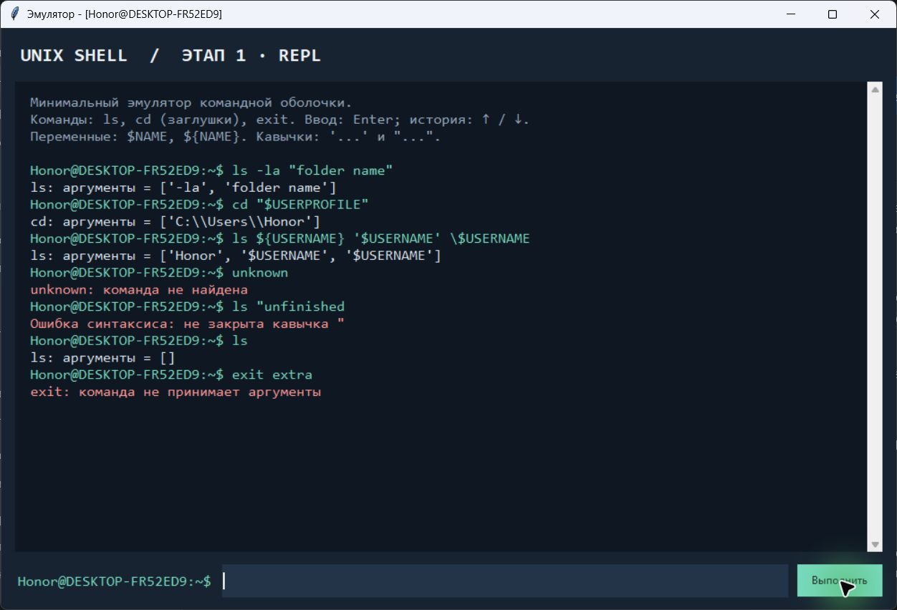

# Этап 1. REPL — эмулятор командной оболочки

Практическая работа по дисциплине «Конфигурационное управление».

Графический прототип UNIX-подобной оболочки на Python и Tkinter.
Реализован цикл REPL: чтение строки → разбор → выполнение команды → вывод
результата → ожидание следующей строки.

## Запуск

Требуется Python 3.10 или новее с Tkinter. Сторонних Python-зависимостей нет.
На Windows Tkinter входит в стандартный установщик Python при включённом
компоненте Tcl/Tk. Проверка наличия: `python -m tkinter`.

Из корня репозитория:

```console
python 1_1/main.py
```

Или из папки `1_1`:

```console
python main.py
```

Команды вводятся **в нижнем поле открывшегося окна**. Нажмите Enter или кнопку
«Выполнить». Стрелки ↑ и ↓ позволяют перемещаться по истории; при возвращении
в конец истории восстанавливается незавершённая строка. История хранится до
закрытия приложения. Вывод доступен для выделения и копирования, но защищён
от редактирования. Длинный вывод можно прокручивать.

## Выполнение требований

| Требование этапа | Реализация |
| --- | --- |
| Графический интерфейс | Окно Tkinter с областью вывода, приглашением и полем ввода |
| Заголовок из реальных данных ОС | `Эмулятор - [username@hostname]`; данные берутся через `getpass.getuser()` и `socket.gethostname()` |
| Раскрытие переменных окружения | `$NAME` и `${NAME}` из `os.environ`, включая `$HOME`, если она задана в ОС |
| Заглушки `ls`, `cd` | Вывод имени команды и списка разобранных аргументов |
| Команда `exit` | Закрывает окно и завершает цикл приложения |
| Интерактивная демонстрация и ошибки | Сценарий ниже и скриншот реального GUI |
| Коммит в репозитории | Изменения этапа сохраняются отдельным коммитом `feat: ...` |

## Правила разбора

- Пробелы и табуляция разделяют аргументы; пустая строка не выполняет команду.
- Двойные кавычки сохраняют пробелы в аргументе и допускают раскрытие переменных:
  `cd "$HOME"`.
- Одинарные кавычки сохраняют текст буквально: `ls '$HOME'`.
- Обратная косая черта экранирует следующий символ: `ls my\ folder`,
  `ls \$HOME`. В двойных кавычках она экранирует только `$`, обратную кавычку,
  `"`, `\` и перевод строки.
- Незаданная переменная раскрывается в пустую строку. В двойных кавычках пустой
  аргумент сохраняется, без кавычек — удаляется.
- Значение переменной без кавычек разделяется по пробелам, табуляции и переводу
  строки. С кавычками оно остаётся одним аргументом.
- Раскрытое значение не разбирается повторно как команды или переменные.
- `#` в начале нового слова начинает комментарий; в кавычках это обычный символ.
- Имена переменных имеют вид `[A-Za-z_][A-Za-z0-9_]*`.

На этапе 1 `ls` и `cd` остаются заглушками: файловая система и рабочий каталог
не изменяются, существование путей не проверяется. Приглашение `:~$` — оформление
прототипа. Подстановка команд, конвейеры, перенаправления и операторы выполнения
не реализованы; при их вводе приложение сообщает об ошибке. Раскрытие `~`,
шаблонов `*`/`?`, специальных shell-параметров и присваивания переменных также
не входит в этот этап. `%NAME%` — синтаксис Windows CMD; здесь используется `$NAME`.

## Интерактивная демонстрация

Проверено в реальном GUI на Windows, Python 3.14.0 / Tk 8.6.
Ввод выполнялся через интерфейс приложения; скриншот содержит результаты
команд и обработки ошибок.



Повторите следующие действия после запуска:

| Ввод / действие | Ожидаемый результат |
| --- | --- |
| `ls -la "folder name"` | `ls: аргументы = ['-la', 'folder name']` |
| `cd "$USERPROFILE"` (Windows) | `cd` выводит путь профиля из окружения ОС одним аргументом |
| `cd "$HOME"` (Linux/macOS) | Аналогичная проверка домашнего каталога, если переменная задана |
| `ls ${USERNAME} '$USERNAME' \$USERNAME` (Windows) | Первый аргумент — значение переменной; второй и третий — буквальный `$USERNAME` |
| `unknown` | `unknown: команда не найдена`; окно остаётся открытым |
| `ls "unfinished` | `Ошибка синтаксиса: не закрыта кавычка "`; окно остаётся открытым |
| ↑, затем ↓ | Предыдущая строка появляется в поле; затем возвращается новая строка |
| `ls`, кнопка «Выполнить» | `ls: аргументы = []`, подтверждение работы после ошибок |
| `exit extra` | `exit: команда не принимает аргументы`; окно остаётся открытым |
| `exit`, Enter | Окно закрывается, процесс приложения завершается |

Имена пользователя, компьютера и значения переменных зависят от текущей ОС.
В Linux/macOS вместо `${USERNAME}` можно использовать `${USER}`.
Для дополнительной проверки ошибок введите `ls ${HOME`, `ls ${BAD-NAME}`
или `ls | cd`: появится сообщение об ошибке синтаксиса.
Для проверки пустой переменной введите `ls "$REPL_UNDEFINED_1_1"` при условии,
что такая переменная не задана: результатом будет `ls: аргументы = ['']`.

## Автоматические тесты

Из корня репозитория:

```console
python -m unittest discover -s 1_1 -v
```

Из папки `1_1`:

```console
python -m unittest -v
```

9 тестов с наборами входных данных проверяют разбор аргументов, кавычки,
экранирование, переменные (включая реальные переменные процесса), неверный
синтаксис, заглушки, отсутствие изменения рабочего каталога, неизвестные
команды, восстановление после ошибок, `exit` и формирование заголовка.
Эти тесты не требуют графического дисплея; сам GUI проверяется по сценарию выше.

## Структура

```text
1_1/
├── main.py                   # GUI и цикл взаимодействия
├── shell.py                  # Парсер, данные ОС, обработчики команд
├── test_shell.py             # Автоматические тесты
├── README.md                 # Запуск, описание и демонстрация
└── docs/
    └── interactive-demo.png  # Скриншот работающего приложения
```
